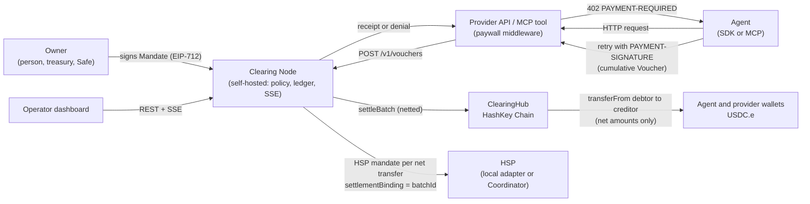

# Architecture and threat model

## 1. Components

## 2. Why each design choice

- Cumulative vouchers instead of per-call transfers: one signature per call, zero gas per call, and only the latest voucher per (mandate, payee) ever goes on chain.
- Multilateral netting on chain, not just off chain: the hub recomputes every position from signed vouchers, so the node cannot invent or inflate a debt.
- Direct `transferFrom` between wallets: the hub never holds a balance, which keeps it non-custodial and keeps every net transfer visible to HSP as a plain ERC-20 transfer from payer to payee.
- Owner mandate plus agent key: the owner sets the budget once, the agent key only spends inside it, and either can revoke.
- Merkle root of every call receipt on chain: any single call is provable later with a 10-hash proof, without storing calls on chain.
- SQLite with `BEGIN IMMEDIATE`: a self-hosted node needs zero infrastructure, and serialized writes make overspending impossible even under parallel calls.

## 3. Trust model

| Party | Can | Cannot |
|---|---|---|
| Owner | Set caps, allowlist and expiry; revoke. | Spend: only the agent key signs vouchers. |
| Agent | Spend inside the mandate; revoke. | Exceed the total cap, pay a non-allowlisted payee, or settle after the grace window: all enforced on chain. |
| Node operator | Refuse calls; choose when to settle; pay settlement gas. | Move funds without agent-signed vouchers, change amounts, or pay itself. Per-call and daily caps are node-enforced, the rest is contract-enforced. |
| Provider | Get paid for served calls even if the node disappears: it holds the agent-signed voucher and can settle it directly. | Claim more than the agent signed. |
| Anyone | Call `settleBatch` with valid vouchers. | Redirect funds: payees are inside the signed vouchers. |

## 4. Known limitations and mitigations

- Front-running `settleBatch`: a copy of pending claims under another batch id moves funds to exactly the same payees, so no value is at risk; the node reconciles from `VoucherSettled` events. HashKey Chain is an OP Stack chain, and OP Stack sequencers usually do not expose a public mempool, which makes this unlikely in practice.
- A debtor that removes its allowance makes a batch revert: the node pre-checks balances and allowances and leaves unpayable mandates out of the batch.
- Per-call and daily caps live off chain because enforcing them on chain would need one transaction per call; the `policyHash` in the mandate commits to them, so the owner can always prove what was agreed.
- 64 claims per batch bounds gas; the node splits larger settlements into several batches.
- HSP official SDK is not yet public; the node implements HSP wire v1 behind one interface and switches to the Coordinator when keys arrive.
