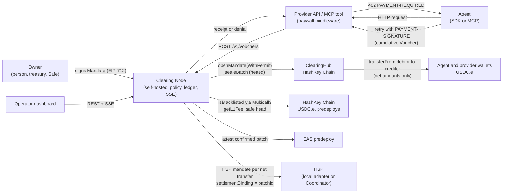

# Architecture and threat model

## 1. Components

## 2. Why each design choice

- Cumulative vouchers instead of per-call transfers: one signature per call, zero gas per call, and only the latest voucher per (mandate, payee) ever goes on chain.
- Multilateral netting on chain, not just off chain: the hub recomputes every position from signed vouchers, so the node cannot invent or inflate a debt.
- Direct `transferFrom` between wallets: the hub never holds a balance, which keeps it non-custodial and keeps every net transfer visible to HSP as a plain ERC-20 transfer from payer to payee.
- Owner mandate plus agent key: the owner sets the budget once, the agent key only spends inside it, and either can revoke.
- Merkle root of every call receipt on chain: any single call is provable later with a 10-hash proof, without storing calls on chain.
- SQLite with `BEGIN IMMEDIATE`: a self-hosted node needs zero infrastructure, and serialized writes make overspending impossible even under parallel calls.
- Book at the safe head, not at inclusion: HashKey Chain's unsafe head can reorg, so a batch is `included` at one confirmation and `confirmed` (ledger, positions, HSP, EAS) only once its block is at or below `CONFIRM_TAG` (default `safe`). Until then the node keeps the signed transaction and rebroadcasts it if a reorg drops it.
- One operator sender: every operator transaction (open, revoke, settle, attest) goes through one serial queue that owns the nonce, preflights gas plus the OP Stack L1 data fee, and replaces a stuck transaction with the same nonce and 12.5 % higher fees.
- Permits over approvals: `openMandateWithPermit` lets an agent start with zero HSK, which removes the most common onboarding failure for agent wallets (no gas for `approve`).
- Screen before sending: USDC.e reverts any transfer that touches a blacklisted address, and one such transfer would revert the whole netted batch, so the node checks every party in one Multicall3 read and leaves affected claims out.

## 3. Trust model

| Party | Can | Cannot |
|---|---|---|
| Owner | Set caps, allowlist and expiry; revoke. | Spend: only the agent key signs vouchers. |
| Agent | Spend inside the mandate; revoke. | Exceed the total cap, pay a non-allowlisted payee, or settle after the grace window: all enforced on chain. |
| Node operator | Refuse calls; choose when to settle; pay settlement gas. | Move funds without agent-signed vouchers, change amounts, or pay itself. Per-call and daily caps are node-enforced, the rest is contract-enforced. Make the agent sign above its own position: a reported position above what the agent signed is refused (`POSITION_UNVERIFIED`). |
| Provider | Get paid for served calls even if the node disappears: it holds the agent-signed voucher and can settle it directly. | Claim more than the agent signed. Steer the agent: positions in a 402 body and the node named in a requirement are ignored, and receipts count only if signed by the operator of the agent's configured node. |
| Anyone | Call `settleBatch` with vouchers that settle a non-zero amount; submit a permit they observe. | Redirect funds: payees are inside the signed vouchers. Make a receipt provable: a proof counts only if the batch settler is the node operator and the operator signed the leaf. Block onboarding by front-running a permit: the hub accepts a consumed permit when the allowance it set is in place. |

What the agent trusts, and why each is bounded:
- The agent talks to one clearing node, configured by URL (`nodeUrl`, required); it never learns a node, a position or an operator from a provider.
- Every voucher's cumulative is at most the highest cumulative the agent itself signed for that (mandate, payee) plus the call price; the high-water mark is written to the agent's store before the signature exists.
- So a lying provider or node can make one call cost at most its advertised price, which the policy guard bounds by the per-call cap, never the rest of the mandate.
- Receipts are accepted only if they match the signed voucher and are signed by the operator address the configured node reports in `GET /v1/info`.
- A receipt proof (node route, SDK `verifyReceiptOnchain`, MCP `prove_receipt`) is verified only if `batches[batchId].settler` is the node operator and the operator signed the leaf, because `settleBatch` is permissionless and a root alone proves nothing.

## 4. Known limitations and mitigations

- Front-running `settleBatch`: a copy of pending claims under another batch id moves funds to exactly the same payees, so no value is at risk; the node reconciles from `VoucherSettled` events. HashKey Chain is an OP Stack chain, and OP Stack sequencers usually do not expose a public mempool, which makes this unlikely in practice.
- A front-runner can store its own `receiptsRoot` next to real vouchers, and a batch of only already-settled vouchers now reverts (`NothingToSettle`), so made-up roots cannot be anchored for free; proofs additionally require the batch settler to be the node operator.
- Agent state is durable only with a store file (`storePath` in the SDK, `RECEIPT_STORE_PATH` in the MCP server, SQLite in WAL mode); the in-memory default forgets signed positions on restart, after which the agent refuses to extend them (`POSITION_UNVERIFIED`) rather than trust the node.
- Two processes that share one agent key must share one receipt store file; a process that cannot see the other's signatures fails closed with `POSITION_UNVERIFIED`.
- A provider that answers every voucher with `STALE_CUMULATIVE` can collect up to `maxRetries + 1` vouchers for one request, each extending the agent's own position by one price; the per-call cap and the retry limit bound this, as with any x402 provider that takes payment without serving.
- A debtor that removes its allowance makes a batch revert: the node pre-checks balances and allowances and leaves unpayable mandates out of the batch.
- A blacklisted agent or payee would make a USDC.e batch revert: the node screens every party with `isBlacklisted` before simulating and leaves affected claims out; they stay pending and visible.
- A reorg can remove an included settlement: nothing is booked before the finality head passes it, the stored signed transaction is rebroadcast with the same nonce, and the batch's calls return to the queue only once the hub has no record of it and its nonce belongs to another transaction. The hub's cumulative `settled` positions make a double payment impossible in any case.
- A settlement block found only at `latest` delays booking by the safe-head lag (about 24 s on mainnet, about 10 minutes on testnet); providers see `included` immediately.
- Per-call and daily caps live off chain because enforcing them on chain would need one transaction per call; the `policyHash` in the mandate commits to them, so the owner can always prove what was agreed.
- 64 claims per batch bounds gas; the node splits larger settlements into several batches.
- HSP official SDK is not yet public; the node implements HSP wire v1 behind one interface and switches to the Coordinator when keys arrive.
